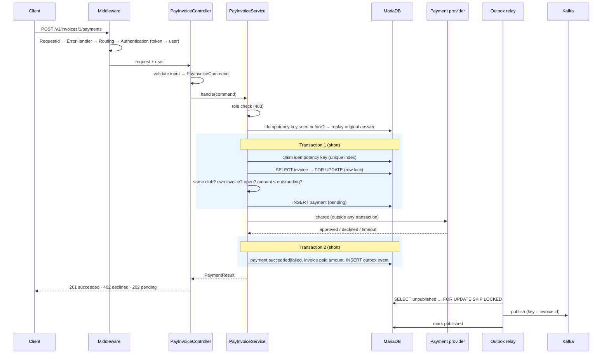

# Club Billing API

[](https://github.com/sahinme/club-billing-api/actions/workflows/ci.yml)

A small payments API for gym memberships, written in PHP 8.4.
A front desk employee (or the member) pays an open invoice by card. The request goes through
authentication, validation, authorization, a database transaction with row locking, a call to a
payment provider, and back. The outcome is also published as an event to Kafka.

It covers the things that matter in billing: money stored as integer cents, idempotent retries,
no double charges under concurrency, tenant isolation between gyms, and honest handling of
"we don't know if the card was charged".

## Run it

Requirements: Docker (with Compose v2) and `make`. Nothing else, not even PHP.

```bash
make up      # builds and starts nginx, PHP-FPM, MariaDB, Kafka and the outbox worker. API on http://localhost:8080
make demo    # 17 scenarios with curl: happy path, retries, declines, timeouts, 401/403/404, two race conditions
make events  # shows the events the worker published to Kafka
make seed    # puts the demo data back to its starting state
make db      # MariaDB shell (GUI clients: 127.0.0.1:3307, user club_billing, password in secrets/db_password.txt)
make test    # 33 PHPUnit tests against a real MariaDB
make qa      # code style + PHPStan (level 8) + tests + composer audit
make reset   # stop everything and delete the data
```

`make up` generates random database passwords into `secrets/` (git-ignored), applies migrations and loads demo data.

## Where the request comes in and where the response goes out

| | File and function |
|---|---|
| Request comes in | [`public/index.php`](public/index.php) (nginx sends every request here) → [`PayInvoiceController::__invoke()`](src/Http/Controller/PayInvoiceController.php#L29) |
| Business logic | [`PayInvoiceService::handle()`](src/Application/Payment/PayInvoiceService.php#L50) |
| Response goes out | [`PayInvoiceController.php` line 41](src/Http/Controller/PayInvoiceController.php#L41) → [`JsonResponder::json()`](src/Http/Response/JsonResponder.php#L23), written to the client by [`$app->run()`](public/index.php#L20) |
| Errors go out | [`ErrorHandlerMiddleware::process()`](src/Http/Middleware/ErrorHandlerMiddleware.php#L38) → [`JsonResponder::problem()`](src/Http/Response/JsonResponder.php#L28) |

### The request, step by step

`POST /v1/invoices/1/payments` with `Authorization: Bearer …`, `Idempotency-Key: …` and `{"amount": 2000, "currency": "EUR", "payment_method": "pm_card_ok"}`



## Interview topics, mapped to lines

### 1. Error handling
- **One place turns every exception into a response:** the [`try`/`catch (Throwable)`](src/Http/Middleware/ErrorHandlerMiddleware.php#L40-L46) in `ErrorHandlerMiddleware`, and the [exception → status map](src/Http/Middleware/ErrorHandlerMiddleware.php#L50-L63).
- **What the user gets:** an RFC 9457 `application/problem+json` body with `status`, `code`, `detail` and a `request_id` ([JsonResponder.php:28](src/Http/Response/JsonResponder.php#L28)). For 4xx the `detail` is a message written for the client. For anything unexpected the client gets only *"Something went wrong… quote the request_id"* ([line 61](src/Http/Middleware/ErrorHandlerMiddleware.php#L61)). No SQL, file names or stack traces. A test breaks the database on purpose and checks this: `testErrorsNeverExposeInternals`.
- **Errors that are part of the flow, handled where they happen:**
  - Provider timeout → [`catch (GatewayTimeout)`](src/Application/Payment/PayInvoiceService.php#L120). The payment stays `pending` and the client gets `202`. We never guess whether money moved.
  - Parallel request with the same key → [`catch (IdempotencyKeyAlreadyClaimed)`](src/Application/Payment/PayInvoiceService.php#L63). The client gets the other request's result.
  - Any exception inside a transaction → [rollback](src/Infrastructure/Database/TransactionManager.php#L27-L40). The rollback itself is guarded so it cannot hide the original error.

### 2. Error logging
- **Where:** JSON lines on stderr ([LoggerFactory.php:26](src/Infrastructure/Logging/LoggerFactory.php#L26)), collected by Docker/Kubernetes and shipped to the log platform.
- **What is recorded:** every line carries `request_id` and `user_id` ([LoggerFactory.php:35](src/Infrastructure/Logging/LoggerFactory.php#L35)). A 5xx is logged with the full exception and stack trace ([ErrorHandlerMiddleware.php:76](src/Http/Middleware/ErrorHandlerMiddleware.php#L76)). A 4xx gets one short `info` line. Business events are logged too: `payment.reserved`, `payment.succeeded`, `payment.gateway_timeout`, `auth.login_failed`.
- **What stays out:**
  - We never log request bodies or headers.
  - [`RedactionProcessor`](src/Infrastructure/Logging/RedactionProcessor.php#L19) is a safety net: it replaces any `password`/`token`/`authorization`/`card`… key with `[REDACTED]` and masks e-mails (`a***@amsterdam.test`).
  - [`zend.exception_ignore_args`](docker/php/app.ini#L12) keeps function arguments out of stack traces.
  - `#[\SensitiveParameter]` is set on password and token parameters.
  - The DB password is wrapped in [`Secret`](src/Infrastructure/Config/Secret.php#L24), which prints as `***`.

### 3. Clean code
- **Layers:** `Http` (in/out) → `Application` (use cases) → `Domain` (rules) → `Infrastructure` (DB, Kafka, logging, config). Controllers are four lines of real work ([PayInvoiceController.php:29-46](src/Http/Controller/PayInvoiceController.php#L29-L46)).
- **The rules live with the data:**
  - [`Invoice::assertCanAcceptPayment()`](src/Domain/Invoice/Invoice.php#L37) holds the invoice rules.
  - [`Money`](src/Domain/Money.php#L15) uses integer cents and refuses to mix currencies.
  - PHP 8.4 `private(set)` ([Invoice.php:25](src/Domain/Invoice/Invoice.php#L25)) means the paid amount can only change through `applyPayment()`.
- **Comments explain *why*, not *what*.** For example, why the provider call happens outside the transaction: [PayInvoiceService.php:23-38](src/Application/Payment/PayInvoiceService.php#L23-L38).
- **Tooling:** PHPStan level 8 and PHP-CS-Fixer (PER-CS) pass with zero findings.
- For what I would clean up with more time, see [Weak spots](#weak-spots-and-what-i-would-do-next).

### 4. Database credentials
- The password is **not in the code and not in any committed file.** `make up` generates a random one into `secrets/` (git-ignored). Compose mounts it as a Docker secret at `/run/secrets/db_password`, and the app is told the *path* ([compose.yaml:17](compose.yaml#L17)).
- [`Config::secret()`](src/Infrastructure/Config/Config.php#L71) reads `DB_PASSWORD_FILE` first, then `DB_PASSWORD`. A missing or empty secret stops the app at startup with the variable *name* only.
- In production the same code works unchanged with Kubernetes secrets or the Vault agent writing a file.
- [`clear_env = no`](docker/php/fpm-pool.conf#L8) is needed because php-fpm otherwise hides environment variables from PHP.

### 5. Login and permissions
- **Hashing:** [`password_hash(…, PASSWORD_ARGON2ID)`](src/Application/Auth/PasswordHasher.php#L26). Argon2id with a random salt per password.
- **Compare:** [`password_verify()`](src/Application/Auth/PasswordHasher.php#L35), which is constant-time.
  - For unknown e-mails we still verify against a [dummy hash](src/Application/Auth/PasswordHasher.php#L22), so response time does not reveal which accounts exist.
  - "Wrong password" and "no such user" get the same message ([LoginService.php:24](src/Application/Auth/LoginService.php#L24)).
  - Old hashes are upgraded on login ([line 32](src/Application/Auth/LoginService.php#L32)).
- **Who is the user on each request:**
  - Login issues a random 256-bit token ([TokenService.php:28](src/Application/Auth/TokenService.php#L28)). The database stores only its SHA-256 ([line 48](src/Application/Auth/TokenService.php#L48)).
  - On every request, [`AuthenticationMiddleware`](src/Http/Middleware/AuthenticationMiddleware.php#L42) looks the token up: it must not be expired or revoked. The middleware then attaches the `User` to the request.
- **What they may do:** two levels in [`Authorizer`](src/Application/Auth/Authorizer.php#L20).
  - **Role level:** `assertCan()` checks the role's permissions ([Role.php:23](src/Domain/User/Role.php#L23)). An auditor gets `403`.
  - **Record level:** `assertCanAccessInvoice()` ([line 32](src/Application/Auth/Authorizer.php#L32)) allows only invoices of the user's own gym, and for members only their own invoices. Otherwise it answers `404`, not `403`, so invoice ids cannot be probed.
  - **In SQL too:** every invoice query also filters on `club_id` ([InvoiceRepository.php:27](src/Infrastructure/Persistence/InvoiceRepository.php#L27)).

### 6. Object-oriented design
- **One responsibility per class:**
  - Controller: HTTP.
  - `*Request`: validation.
  - `*Service`: use case.
  - `Invoice`, `Payment`, `Money`: rules and invariants.
  - `*Repository`: SQL.
  - `JsonResponder`: response format.
- **Interfaces only where there is a real second implementation or an external system:**
  - [`PaymentGateway`](src/Application/Payment/PaymentGateway.php): fake provider here, a real one in production.
  - [`MessagePublisher`](src/Infrastructure/Messaging/MessagePublisher.php): Kafka in production, an in-memory double in tests.
  - Repositories are concrete classes on purpose (see Weak spots).
- **Avoiding duplication:**
  - One error handler for all endpoints.
  - One `JsonResponder` for all bodies.
  - One `PasswordHasher` (the algorithm is written once).
  - One `TransactionManager`.
  - One `Authorizer` used by both endpoints.
- **Wiring:** dependencies are injected through constructors and wired by PHP-DI ([config/container.php](config/container.php)). No `new` of services inside business code, no static state.

### 7. Endpoints and how they are protected
| Endpoint | Access |
|---|---|
| `GET /health` | public (load balancer probe) |
| `POST /v1/auth/login` | public |
| `GET /v1/invoices/{id}` | token + `invoices.view` + same gym (+ own invoice for members) |
| `POST /v1/invoices/{id}/payments` | token + `payments.collect` + same gym (+ own invoice for members) + `Idempotency-Key` |

Authentication is **deny by default**. The middleware runs on every route ([config/app.php:22](config/app.php#L22)), and only names in [`PUBLIC_ROUTES`](src/Http/Middleware/AuthenticationMiddleware.php#L25) skip it. A new route someone adds later is protected without anyone remembering to do it. Route parameters are restricted by regex (`[0-9]+`) in [config/routes.php](config/routes.php#L25-L26).

### 8. Database access
- **Hand-written SQL with PDO.** Every value is a bound parameter, for example [InvoiceRepository.php:27](src/Infrastructure/Persistence/InvoiceRepository.php#L27).
- **No string building.** The one place that builds anything builds only the number of `?` placeholders ([OutboxRepository.php:85](src/Infrastructure/Persistence/OutboxRepository.php#L85)).
- **Real server-side prepares:** [`ATTR_EMULATE_PREPARES => false`](src/Infrastructure/Database/ConnectionFactory.php#L21), so a value can never become SQL.
- **Transactions:** [`TransactionManager::run()`](src/Infrastructure/Database/TransactionManager.php#L23) commits, or rolls back on any exception.
- **Concurrency:**
  - [`SELECT … FOR UPDATE`](src/Infrastructure/Persistence/InvoiceRepository.php#L42) makes two payments for one invoice queue up instead of both seeing the same outstanding amount.
  - The idempotency unique index ([schema:80](database/migrations/001_initial_schema.sql#L80)) makes duplicate retries impossible even at the same millisecond.
  - A `CHECK (amount_paid <= amount_total)` ([schema:48](database/migrations/001_initial_schema.sql#L48)) is the last line of defence.
  - `make demo` steps 14 and 15 fire 5 parallel requests and show exactly one charge.
- **The provider call is outside the transaction:** the use case uses two short transactions around it ([PayInvoiceService.php:62](src/Application/Payment/PayInvoiceService.php#L62) and [73](src/Application/Payment/PayInvoiceService.php#L73)). A slow provider never holds DB locks, and a rollback cannot "undo" a card charge anyway.
- **Kafka (transactional outbox):** the event is written in the same transaction as the payment ([PayInvoiceService.php:147](src/Application/Payment/PayInvoiceService.php#L147)). A separate worker publishes it ([OutboxRelay.php:62](src/Infrastructure/Messaging/OutboxRelay.php#L62)) with `acks=all` and an idempotent producer. This avoids the dual-write problem: the database and Kafka can never disagree about whether a payment happened.

### 9. General good practice
- **Tests:** 33 tests, run with `make test`.
  - Unit tests for `Money`, `Invoice` and log redaction.
  - Integration tests send real HTTP requests through the whole app against real MariaDB: auth, every payment outcome, idempotency, tenant isolation, error hiding, and the outbox when Kafka is down.
- **Input validation:** allow-list per field, and all errors are returned at once ([PayInvoiceRequest.php:23](src/Http/Request/PayInvoiceRequest.php#L23)).
  - Amount must be an integer in cents with a ceiling.
  - Currency must be ISO 4217.
  - The card must be a provider token. Raw card numbers are refused (PCI DSS).
  - JSON depth is limited ([JsonBody.php:13](src/Http/Request/JsonBody.php#L13)) and nginx caps the body at 16 KB.
- **Dependencies:**
  - `composer.lock` is committed, so builds are reproducible.
  - [Dependabot](.github/dependabot.yml) opens weekly PRs for Composer packages, Docker base images and GitHub Actions.
  - `composer audit` runs in CI and fails on known vulnerabilities.
- **Review:** [CI](.github/workflows/ci.yml) runs `make ci` on every PR: style, PHPStan, tests, audit, production image build. On top of green CI, a human reviewer looks at:
  - money math,
  - transaction boundaries,
  - authorization on any new endpoint,
  - anything written to logs,
  - and migrations: they must be backwards compatible, expand first and contract later.
- **Deploy:**
  - The [`prod` image stage](Dockerfile#L33) has no dev tools, tests or seed data, runs as `www-data` and has OPcache locked.
  - Tag the image with the git SHA and push it to the registry.
  - Run migrations as a Kubernetes Job / Helm pre-upgrade hook.
  - Then do a rolling update gated by the `/health` readiness probe.
  - Rollback means deploying the previous image tag.

## Weak spots and what I would do next

Being direct about what is rough:

1. **Pending payments are never resolved.** After a provider timeout, or a crash between the charge and transaction 2, a payment stays `pending` and blocks that invoice. A reconciliation job should ask the provider for the charge status (using our `payment-{id}` idempotency key) and settle it. I'd also add provider webhooks.
2. **Settling can fail after money moved.** If `settle()` throws after an approved charge (for example the invoice was voided through another path), transaction 2 rolls back. The provider reference then survives only in the logs. Better: always record the succeeded payment, and flag the mismatch for a refund or manual review.
3. **Application services depend on concrete repositories.** It is simple and readable, but `PayInvoiceService` can only be tested with a database. With more use cases I'd put repository interfaces in the domain layer and add fast unit tests for the service.
4. **No brute-force protection on login.** I'd add rate limiting per IP and per e-mail (Redis or the API gateway), plus temporary lockout.
5. **Tokens:** no logout/revoke endpoint yet (the `revoked_at` column is ready), no refresh tokens, and old rows are never cleaned up. Idempotency keys also never expire. They need a TTL (24h is common) and a cleanup job.
6. **Outbox:**
   - Published rows are never deleted.
   - With several relay instances, `SKIP LOCKED` can reorder events of the same invoice, so I run one instance. At scale I'd move to CDC (Debezium) or partition the relay by key.
   - No consumer is built; consumers must deduplicate on `event_id` (at-least-once delivery).
7. **No deadlock retry.** `TransactionManager` should retry a few times on MariaDB error 1213.
8. **Hand-rolled pieces:**
   - The migration runner is minimal (DDL is not transactional in MariaDB); I'd use Doctrine Migrations.
   - Validation is hand-written; I'd use an OpenAPI spec plus request validation generated from it.
   - The PHP-DI container should be compiled in production.
9. **Observability:** logs only. I'd add metrics (payment success rate, provider latency, outbox lag) and OpenTelemetry tracing across the API, the relay and Kafka.
10. **Concurrency is proven by the demo script, not by PHPUnit.** A test with parallel processes would make it part of CI.

## Demo users

All demo users share the password `demo-password`. These users exist only in the dev seed ([database/seed](database/seed/DemoDataSeeder.php)), which is not in the production image.

| E-mail | Role | Gym |
|---|---|---|
| `frontdesk@amsterdam.test` | front desk: all invoices of the gym | Amsterdam |
| `auditor@amsterdam.test` | auditor: read-only | Amsterdam |
| `anna@amsterdam.test`, `bob@amsterdam.test` | member: own invoices only | Amsterdam |
| `frontdesk@rotterdam.test` | front desk | Rotterdam |

Test cards for the fake provider: `pm_card_ok`, `pm_card_declined`, `pm_card_insufficient_funds`, `pm_card_timeout`.

```bash
TOKEN=$(curl -s -X POST localhost:8080/v1/auth/login -H 'Content-Type: application/json' \
  -d '{"email":"frontdesk@amsterdam.test","password":"demo-password"}' | jq -r .access_token)

curl -s -X POST localhost:8080/v1/invoices/1/payments \
  -H "Authorization: Bearer $TOKEN" -H 'Content-Type: application/json' -H "Idempotency-Key: $(uuidgen)" \
  -d '{"amount":2000,"currency":"EUR","payment_method":"pm_card_ok"}' | jq
```

To try the API by hand, open [`requests.http`](requests.http): every scenario as a ready request, with the
tokens passed along automatically. It runs in PhpStorm without a plugin, or in Cursor / VS Code with the
httpyac extension. Run `make seed` first for a clean state.

## Project layout

```
public/index.php          HTTP entry point
config/                   app.php (middleware order), routes.php, container.php (DI wiring)
src/Http/                 controllers, middleware, input validation, JSON responses
src/Application/          use cases (PayInvoiceService, LoginService, ...), authorization
src/Domain/               Invoice, Payment, Money, User, Role: rules without I/O
src/Infrastructure/       PDO repositories, transactions, config/secrets, logging, Kafka, fake provider
database/migrations/      SQL schema
database/seed/            demo data (dev only)
bin/                      migrate, seed, outbox-relay worker
tests/                    Unit/ and Integration/ (real MariaDB)
docker/, compose.yaml     nginx, php-fpm, MariaDB, Kafka (KRaft), outbox relay
```

Stack: PHP 8.4, Slim 4 (PSR-7/15), PHP-DI, Monolog, MariaDB 11.4, Apache Kafka 3.9 via php-rdkafka, PHPUnit 12, PHPStan 2.

I chose Slim + plain PDO over Laravel/Symfony on purpose: for this review every security-relevant line (hashing, the token lookup, prepared statements, transactions) should be visible in this repository, not inside framework internals.
